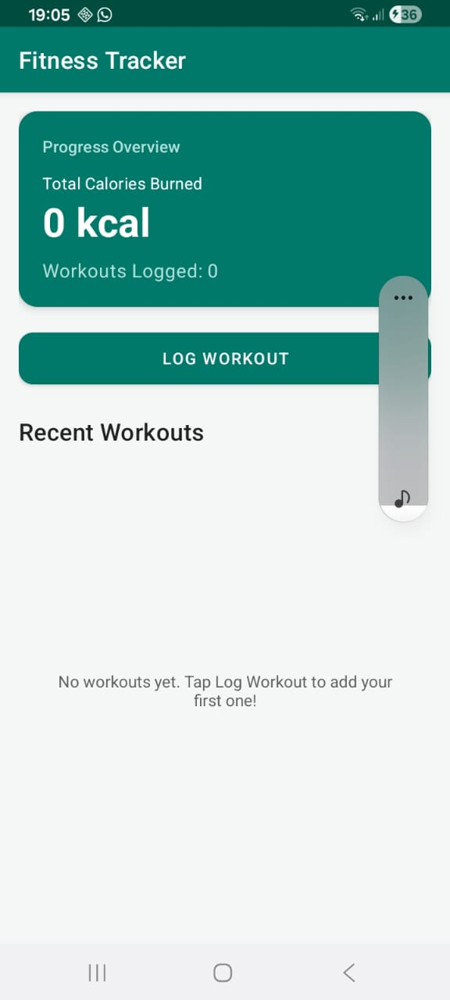
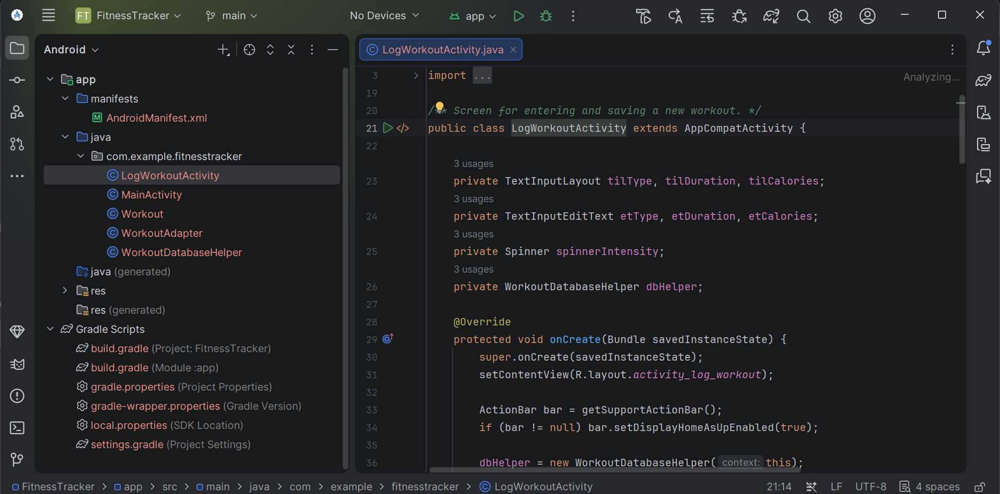
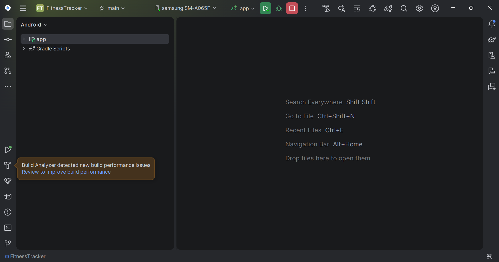

# Fitness Tracker

An Android app for logging workouts and tracking calories burned. I built it for the SWE205 Mobile Application Development practical at Bindura University of Science Education (BUSE).

Workouts are stored in a local SQLite database, so the data stays on the phone and is still there after the app is closed.

## Screenshots

| Main screen |
|---|
|  |

| Project in Android Studio | Running on a Samsung A06 |
|---|---|
|  |  |

More screenshots of the code and build are in the [`screenshots`](screenshots) folder.

## Features

- Progress overview card showing total calories burned and number of workouts logged
- Log a workout with type, duration (minutes), calories burned and intensity (Low, Medium, High)
- Recent workouts shown in a scrolling list, newest first, with date and time
- Delete a workout, with a confirmation dialog first
- Input validation with error messages under each field
- Empty state message when there are no workouts yet
- Data saved in SQLite and loaded again on every launch

## Tech stack

| | |
|---|---|
| Language | Java |
| UI | XML layouts, Material Components, RecyclerView, MaterialCardView |
| Database | SQLite through `SQLiteOpenHelper` |
| Min SDK | 24 (Android 7.0) |
| Target / compile SDK | 34 |
| Build | Gradle 8.2, Android Gradle Plugin 8.2.2, JDK 17 |
| IDE | Android Studio |

## Project structure

```
app/src/main/
├── java/com/example/fitnesstracker/
│   ├── MainActivity.java            main screen: summary card, list, delete
│   ├── LogWorkoutActivity.java      form for adding a workout
│   ├── Workout.java                 model class for one workout
│   ├── WorkoutAdapter.java          RecyclerView adapter for the list
│   └── WorkoutDatabaseHelper.java   SQLite create, insert, query, delete
├── res/
│   ├── layout/
│   │   ├── activity_main.xml
│   │   ├── activity_log_workout.xml
│   │   └── item_workout.xml
│   └── values/                      strings, colors, theme
└── AndroidManifest.xml
```

## Database

Database name: `FitnessTrackerDB`, table: `Workouts`

| Column | Type | Notes |
|---|---|---|
| `id` | INTEGER | primary key, autoincrement |
| `workoutType` | TEXT | for example Running |
| `duration` | INTEGER | minutes |
| `caloriesBurned` | INTEGER | kcal |
| `intensity` | TEXT | Low, Medium or High |
| `date` | TEXT | saved as `yyyy-MM-dd HH:mm` |

`WorkoutDatabaseHelper` has these methods:

| Method | What it does |
|---|---|
| `addWorkout(...)` | inserts a row and returns its id, or -1 if it failed |
| `getAllWorkouts()` | returns every workout, newest first |
| `deleteWorkout(id)` | deletes one row, returns true if a row was removed |
| `getTotalCalories()` | sum of all calories, 0 when the table is empty |
| `getWorkoutCount()` | number of rows |

Each method catches `SQLException` and logs it, so a database problem does not crash the app.

## How it works

**Main screen.** `MainActivity` loads the workouts, the calorie total and the workout count in `onResume()`. Because of that, the list and the totals refresh by themselves when I come back from the log screen or after a delete.

**Logging a workout.** `LogWorkoutActivity` reads the three fields and the spinner. Validation rules:

- Workout type cannot be empty
- Duration must be a whole number greater than 0
- Calories must be a whole number greater than 0
- Numbers that are too large for an int are rejected with their own message

If a field is invalid, the error shows under that field and nothing is saved. If everything is valid, the workout is inserted with the current date and time, a toast is shown and the screen closes.

**Deleting.** Each card in the list has a bin icon. `WorkoutAdapter` calls back to `MainActivity` through the `OnDeleteClickListener` interface. `MainActivity` shows a confirmation dialog, and only if I confirm does it call `deleteWorkout()` and reload the data.

## Running the project

Requirements: Android Studio and an Android phone or emulator on Android 7.0 or newer.

1. Clone the repository
   ```
   git clone https://github.com/<my-username>/FitnessTracker.git
   ```
2. In Android Studio choose **File > Open** and select the project folder.
3. Set **File > Settings > Build, Execution, Deployment > Build Tools > Gradle > Gradle JDK** to a JDK 17. Gradle 8.2 does not run on newer JDKs such as 25.
4. Wait for the Gradle sync to finish. Android Studio will ask to install SDK Platform 34 if it is missing.
5. Pick a device and press **Run**.

To run on a phone, turn on **Developer options** and **USB debugging**, connect it with a data cable and allow the debugging prompt on the phone.

## Problems I ran into

- **Gradle and JDK versions.** My Android Studio ships with JDK 25, but Gradle 8.2 only supports JDK 8 to 19. I downloaded JDK 17 and set it as the Gradle JDK.
- **Downloads timing out.** The SDK, JDK and Gradle downloads kept timing out on my connection. Retrying, and using a hotspot, fixed it. I skipped the emulator and tested on a real phone.
- **Phone not showing up.** The phone only appeared in the device list after I changed the USB mode to file transfer and accepted the debugging prompt.

## Testing

I tested on a Samsung Galaxy A06 (SM-A065F). Things I checked:

- Saving with empty fields shows errors and saves nothing
- Saving with valid input adds a card and updates both totals
- Deleting asks for confirmation and updates the totals
- Closing and reopening the app keeps the saved workouts

## Author

Siyabonga Moyo
Software Engineering, Bindura University of Science Education
